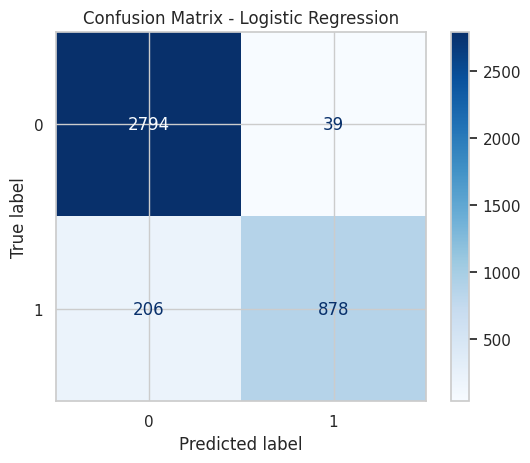
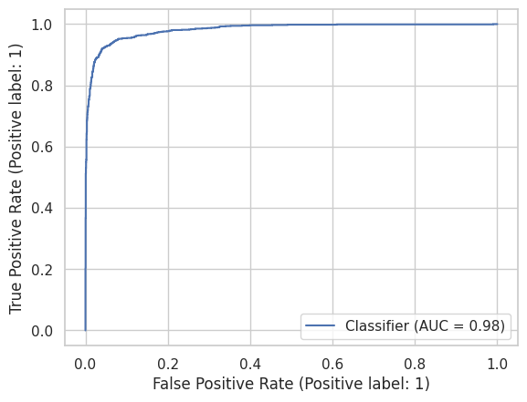

# 📝 Reviews — Sentiment Analysis & Topic Modeling

NLP-проект для анализа англоязычных отзывов об Amazon. **TF-IDF + Logistic Regression** определяют положительную или отрицательную тональность, а **LDA** выделяет темы обсуждений. В Jupyter Notebook собраны подготовка данных, обучение, оценка качества и интерактивный ввод своего отзыва.

---

## 💡 Пример реализации

<table>
  <tr>
    <td width="50%"></td>
    <td width="50%"></td>
  </tr>
  <tr>
    <td align="center"><b>Матрица ошибок</b></td>
    <td align="center"><b>ROC-кривая</b></td>
  </tr>
  <tr>
    <td colspan="2"></td>
  </tr>
  <tr>
    <td colspan="2" align="center"><b>Темы отзывов и наиболее значимые слова</b></td>
  </tr>
</table>

Галерея использует скриншот проекта и графики из сохранённого вывода ноутбука.

---

## 🚀 Ключевые возможности

- **Предобработка текста** — удаление HTML и URL, фильтрация коротких записей, некорректных рейтингов и дубликатов.
- **Классификация тональности** — TF-IDF с униграммами и биграммами, логистическая регрессия.
- **Оценка качества** — accuracy, ROC-AUC, ROC-кривая и матрица ошибок.
- **Анализ ошибок** — ложные положительные и отрицательные ответы, длина текстов, распределение по странам.
- **Интерпретация модели** — слова и словосочетания с наибольшими положительными и отрицательными коэффициентами.
- **Тематический анализ** — пять тем LDA, топ слов каждой темы и интерактивная визуализация pyLDAvis.
- **Свой пример** — ввод англоязычного отзыва и получение класса с оценкой модели.

---

## 🛠 Технологический стек

- **Python, Jupyter Notebook**
- **pandas, NumPy** — обработка данных
- **scikit-learn** — TF-IDF, Logistic Regression, CountVectorizer, LDA и метрики
- **Matplotlib, Seaborn** — графики
- **NLTK** — английские стоп-слова для частотного анализа
- **pyLDAvis** — интерактивное исследование тем

---

## 📈 Этапы реализации

### 1. Данные и подготовка

В [Amazon_Reviews.csv](Amazon_Reviews.csv) — **21 214 записей**. После очистки и исключения нейтральных отзывов остаются **19 582**: 14 157 отрицательных и 5 425 положительных.

Ссылка на источник, указанная в исходном проекте: [Amazon Reviews Dataset на Kaggle](https://www.kaggle.com/datasets/dongrelaxman/amazon-reviews-dataset/data).

Ноутбук обрабатывает `Rating`, `Review Title`, `Review Text` и `Country`. Классификатор использует **только текст отзыва**; метка строится по рейтингу:

| Рейтинг | Метка |
| --- | --- |
| 1–2 звезды | `-1` — отрицательная |
| 3 звезды | Исключается из классификации |
| 4–5 звёзд | `1` — положительная |

Таким образом оценивается соответствие текста рейтингу автора. Лемматизация в текущем коде не выполняется.

### 2. Обучение и оценка классификатора

Данные разделяются на train / test в пропорции **80 / 20**, `random_state=42`.

- **TfidfVectorizer**: `ngram_range=(1, 2)`, `stop_words="english"`, `max_features=10000`.
- Векторизатор обучается только на train; test преобразуется через `transform`.
- **LogisticRegression**: `max_iter=2000`.

Сохранённые результаты [reviews.ipynb](reviews.ipynb):

| Метрика | Значение |
| --- | ---: |
| Accuracy | 0.9375 |
| ROC-AUC | 0.9823 |

<details>
<summary>Об оценке качества</summary>

Метрики и графики взяты из опубликованного запуска ноутбука; при оформлении README модель не переобучалась. Precision, recall и F1 в текущем ноутбуке не выводятся.

Разбиение случайное, без stratify. Классы несбалансированы; переноса на другой период, источник или язык этот эксперимент не проверяет. Метки получены из рейтингов, поэтому расхождения между текстом и рейтингом влияют на оценку.

В сохранённой матрице ошибок оси подписаны индексами 0 и 1: они соответствуют классам -1 и 1. Версии зависимостей не зафиксированы; точное повторение метрик в другом окружении не проверено.

</details>

### 3. Темы и анализ собственных отзывов

Для тематической модели используется отдельный **CountVectorizer** с английскими стоп-словами и до 5 000 признаков. **LatentDirichletAllocation** выделяет пять тем на очищенном наборе, `random_state=42`.

В pyLDAvis можно выбирать тему, смотреть её характерные слова и менять параметр релевантности. LDA исследует темы независимо от классификатора тональности.

Последняя ячейка ноутбука принимает свой текст, выводит класс `-1 / 1` и максимальное значение `predict_proba` — оценку выбранного класса.


---

## 🖥 Использование

### Установка

```bash
git clone https://github.com/golovanov-andrei/Reviews.git
cd Reviews
python -m venv .venv
```

Активируйте окружение:

```powershell
# Windows PowerShell
.\.venv\Scripts\Activate.ps1
```

```bash
# macOS / Linux
source .venv/bin/activate
```

Установите библиотеки и английские стоп-слова NLTK:

```bash
python -m pip install notebook pandas numpy scikit-learn matplotlib seaborn nltk pyLDAvis
python -c "import nltk; nltk.download('stopwords')"
```

### Запуск ноутбука

```bash
jupyter notebook reviews.ipynb
```

В ячейке загрузки замените путь Kaggle на локальный файл из репозитория:

```python
df = pd.read_csv("Amazon_Reviews.csv", engine="python")
```

Выполните ячейки по порядку. В последней ячейке вводите отзывы на английском языке; команда **`exit`** завершает ввод.

При выполнении создаются:

| Файл | Содержимое |
| --- | --- |
| `clean_reviews.csv` | Очищенные данные с метками тональности |
| `lda_vis.html` | Интерактивная визуализация тем для просмотра в браузере |

Для анализа своего отзыва сначала выполните ячейки обучения: модель и векторизатор хранятся в памяти текущего ядра Jupyter.

---

## 📂 Структура проекта

```text
Reviews/
├── reviews.ipynb       # Анализ, обучение, оценка и интерактивный ввод
├── Amazon_Reviews.csv # Исходные данные
├── screens/           # Примеры работы и графики для README
└── README.md          # Описание проекта и запуск
```

---

## 👤 Автор

**Андрей Голованов**
[GitHub](https://github.com/golovanov-andrei) · [Telegram](https://t.me/andr3ikaG)
