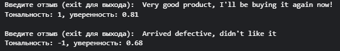
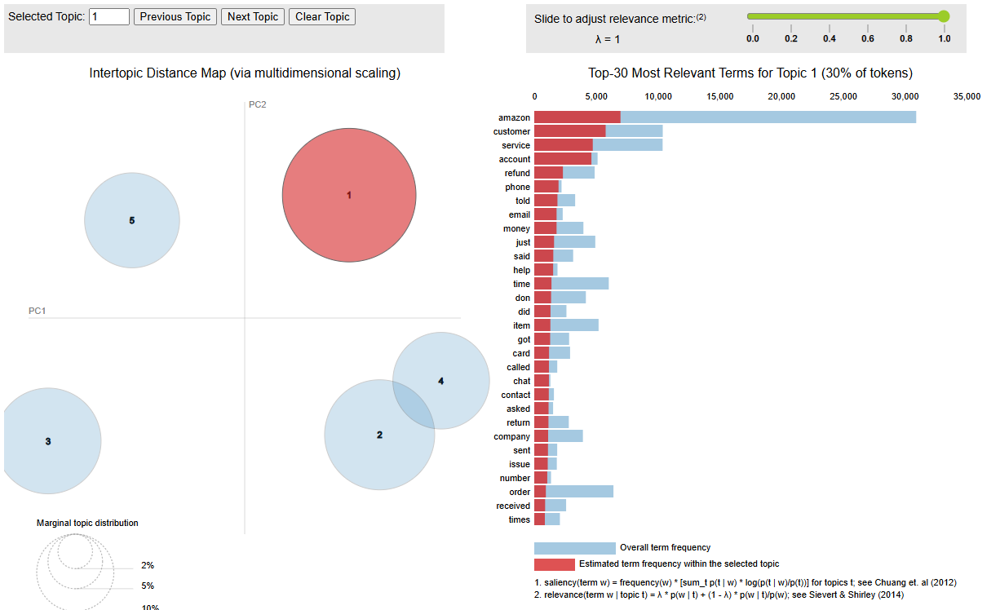

# Reviews — анализ тональности и тем отзывов

Учебный NLP-проект для англоязычных отзывов: **TF-IDF + Logistic Regression** определяют тональность, а **CountVectorizer + LDA** выделяют темы. В ноутбуке также есть анализ ошибок и интерактивный ввод своего текста.

## Данные и целевая переменная

[Amazon_Reviews.csv](Amazon_Reviews.csv) включён в репозиторий. Ссылка на набор, указанная в исходном проекте: [Amazon Reviews Dataset на Kaggle](https://www.kaggle.com/datasets/dongrelaxman/amazon-reviews-dataset/data).

Ноутбук использует `Rating`, `Review Title`, `Review Text` и `Country`. Метки строятся по рейтингу:

| Рейтинг | Метка |
| --- | --- |
| 1–2 звезды | `-1` — отрицательный отзыв |
| 3 звезды | Исключается из классификации |
| 4–5 звёзд | `1` — положительный отзыв |

Это оценка соответствия текста рейтингу автора, а не независимая экспертная разметка тональности.

## Как работает проект

1. Очистка HTML, URL и лишних пробелов, фильтрация коротких записей и некорректных рейтингов, удаление дубликатов текстов.
2. Разделение данных 80/20 с `random_state=42`.
3. TF-IDF: униграммы и биграммы, английские стоп-слова, до 10 000 признаков. Векторизатор обучается только на train.
4. Логистическая регрессия с `max_iter=2000`, матрица ошибок, accuracy и ROC-AUC.
5. Анализ весов слов, ложных положительных и отрицательных ответов.
6. Отдельная тематическая модель LDA: 5 тем, CountVectorizer до 5 000 признаков, визуализация через pyLDAvis.

Лемматизация в текущем коде не выполняется. NLTK импортируется, но скачивание его словарей для имеющегося пути обработки не требуется.

## Структура

| Файл | Назначение |
| --- | --- |
| [reviews.ipynb](reviews.ipynb) | Весь анализ, обучение и интерактивный ввод |
| [Amazon_Reviews.csv](Amazon_Reviews.csv) | Исходные данные |
| [screens/](screens/) | Примеры результатов и тематической визуализации |

При выполнении ноутбука создаются `clean_reviews.csv` и `lda_vis.html`. Отдельного веб-приложения или сохранённой модели в репозитории нет.

## Локальный запуск

```bash
git clone https://github.com/golovanov-andrei/Reviews.git
cd Reviews
python -m venv .venv
```

Активируйте окружение:

```powershell
# Windows PowerShell
.\.venv\Scripts\Activate.ps1
```

```bash
# macOS / Linux
source .venv/bin/activate
```

Установите библиотеки и запустите Jupyter:

```bash
python -m pip install jupyter pandas numpy scikit-learn matplotlib seaborn nltk pyLDAvis
jupyter notebook reviews.ipynb
```

В ячейке загрузки замените путь Kaggle:

```python
df = pd.read_csv("Amazon_Reviews.csv", engine="python")
```

Выполните ячейки по порядку. Последняя ячейка запускает цикл ввода отзывов; команда `exit` завершает его. LDA-визуализация сохраняется в `lda_vis.html`, который можно открыть в браузере.

## Сохранённые результаты

Метрики из опубликованного вывода ноутбука; при обновлении README модель не переобучалась.

| Метрика | Значение |
| --- | ---: |
| Accuracy | 0.9375 |
| ROC-AUC | 0.9823 |

Precision, recall и F1 в текущем ноутбуке не выводятся. Версии библиотек не зафиксированы; повторение метрик в другом окружении не проверено. Случайное разбиение не проверяет переносимость на другой период, источник или язык.

## Примеры




## Дальнейшее развитие

- Зафиксировать зависимости и объединить векторизатор с классификатором в Pipeline.
- Добавить stratified-разбиение, precision/recall/F1 и проверку на отдельном источнике.
- Сохранять модель вместе с векторизатором для повторного инференса.

Автор: [Андрей Голованов](https://github.com/golovanov-andrei).
